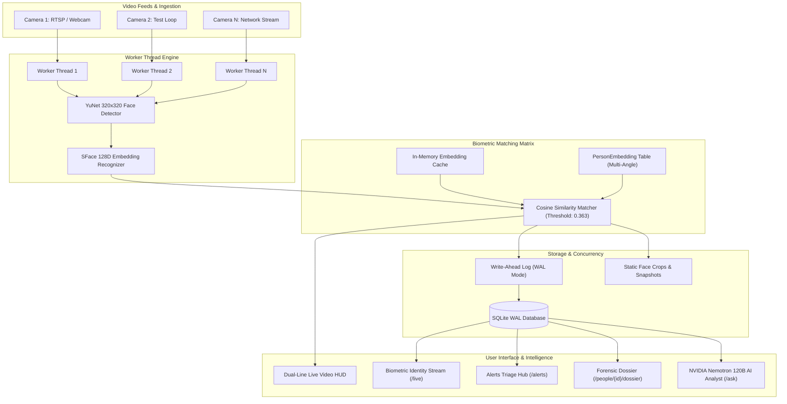

# FaceTrack AI — Enterprise CCTV Facial Surveillance & Intelligence Platform

[](LICENSE)
[](https://www.python.org/)
[](https://fastapi.tiangolo.com/)
[](https://opencv.org/)
[](https://build.nvidia.com/)
[]()

FaceTrack AI is a production-grade, multi-camera intelligent CCTV surveillance and biometric facial recognition system. Built on FastAPI, OpenCV (YuNet + SFace), high-concurrency SQLite WAL architecture, and NVIDIA Nemotron LLM intelligence, the system delivers real-time facial recognition, multi-angle biometric training, automated threat detection, and forensic intelligence for security teams.

---

## Table of Contents

- [Key Implemented Features](#key-implemented-features)
- [System Architecture](#system-architecture)
- [Database Schema & Biometric Storage](#database-schema--biometric-storage)
- [Multi-Angle Recognition Engine](#multi-angle-recognition-engine)
- [Complete REST API Reference](#complete-rest-api-reference)
- [Web Interface Overview](#web-interface-overview)
- [Quickstart Guide](#quickstart-guide)
- [Configuration & Environment Variables](#configuration--environment-variables)
- [Performance & Concurrency Protection](#performance--concurrency-protection)
- [Troubleshooting & Verification](#troubleshooting--verification)

---

## Key Implemented Features

### 1. Dual-Line Real-Time Biometric Video HUD
- Overlays real-time tracking boxes and styled dual-badge identity banners directly on live CCTV streams:
  - **Upper Banner:** Subject Name, 6-Tier Role Badge (`VIP`, `Staff`, `Security`, `Contractor`, `Visitor`, `Banned`), and Cosine Match Similarity Percentage (e.g. `87.4%`).
  - **Lower Banner:** Professional Title & Department, Badge Number (e.g. `Badge #SEC-9041`), and Zone Access Level (e.g. `All Areas Access`).
- Renders bounding boxes dynamically color-coded by role (e.g., Red for Banned, Gold for VIP, Emerald for Staff/Security, Slate for Visitors).

### 2. Multi-Angle & Multi-Sample Biometric Training Engine
- Overcomes the primary failure point of traditional CCTV face recognition (head rotation, camera angle tilt, overhead perspectives).
- Stores multiple 128-dimensional embedding vectors per person (`PersonEmbedding` model).
- Enables enrolling varied angles (Frontal, 45° Left Profile, 45° Right Profile, CCTV Overhead, Hat/Glasses).
- Recognition engine evaluates incoming video against **all enrolled angle vectors** for each subject, selecting the highest similarity match for consistent recognition.

### 3. Real-Time Biometric Identity Stream (`/live`)
- Active side-panel feed alongside the multi-camera grid.
- Instantly populates rich identity dossier cards when a subject passes any camera.
- Displays subject photo, legal name, role, job title, department, badge number, camera location, and timestamp without page refreshes.

### 4. Multi-Camera Grid Matrix (`/live`)
- Responsive multi-stream layout supporting **1x1 Solo Focus**, **2x2 Quad Matrix**, and **3x3 Grid** views.
- Supports concurrent RTSP network streams, USB webcams, and pre-recorded high-definition test loops.
- Camera status monitors report live FPS, resolution, worker thread health, and active stream feeds.

### 5. Dedicated Security Alerts Triage Center (`/alerts`)
- **Zero Toast Spam:** Removed screen-obscuring popups that disrupt operators.
- Centralized incident management hub with real-time severity badges (`Critical`, `Warning`, `Info`).
- One-click filters: All Alerts, Critical Only, Unresolved, and Camera-specific filters.
- Immediate incident actions: Dismiss individual alerts or Clear all resolved alerts.
- Dynamic navigation badge counter updating in real-time as new perimeter incidents occur.

### 6. Automated Blacklist & Suspect Alarms
- Instant critical alarm generated whenever a subject tagged as `Banned / Blacklist` or `High Threat` is detected on any camera feed.
- High-priority logging with exact camera location, timestamp, and face snippet crop.

### 7. Restricted Zone Perimeter Defense & Proximity Points
- Interactive proximity points and bounding coordinate zones for sensitive doors, server rooms, or vaults.
- Triggers unauthorized zone crossing alerts when visitors or non-cleared staff enter restricted zones.

### 8. Smart Dwell Duration & Loitering Analytics
- Automatically calculates how long a subject has lingered in a specific camera zone.
- Flags suspicious loitering patterns when dwell times exceed configured safety thresholds.

### 9. High-Resolution Face Crop Snippet Archive
- Automatically isolates, crops, and normalizes high-resolution facial thumbnails for every sighting.
- Displayed across the Sightings Audit Log (`/sightings`), Personnel Dossiers, and Alert incident cards for rapid visual verification.

### 10. One-Click Instant Forensic Snapshot
- Live CCTV streams feature a camera snapshot tool.
- Captures the exact high-definition raw frame with visual overlays, saving it to `app/static/snapshots/` with forensic timestamping.

### 11. Printable Biometric Intelligence Dossier (`/people/{id}/dossier`)
- Generates a full executive biometric intelligence dossier for any registered subject.
- Includes photo gallery, primary & secondary enrolled angles, total sightings count, average match confidence, camera location distribution, and recent sightings timeline.
- Styled for print or PDF export.

### 12. Forensic Audit Log & One-Click CSV Export (`/sightings`)
- Comprehensive audit table of all historical camera sightings.
- Multi-parameter filtering by Person Name, Camera Feed, Date/Time range, and Threat Level.
- Dedicated `/api/v1/export/sightings.csv` endpoint generates standard CSV forensic exports for external compliance reporting.

### 13. NVIDIA Nemotron AI Security Analyst (`/ask`)
- Natural language security intelligence assistant connected to NVIDIA's `nvidia/nemotron-3-super-120b-a12b` model.
- Analyzes live surveillance context, sighting frequencies, camera anomalies, and security policies to answer natural language operator inquiries.

### 14. SQLite WAL High-Concurrency Architecture
- Multi-camera surveillance writes hundreds of detections concurrently.
- Configured with SQLite Write-Ahead Logging (`PRAGMA journal_mode=WAL;`), 30-second busy timeout (`PRAGMA busy_timeout=30000;`), and `NORMAL` synchronous mode to eliminate database lock issues.

### 15. Anti-Spam Debounce & Duplicate Registration Prevention
- `AUTO_ENROLL=false` prevents random faces from creating phantom database entries.
- 5.0-second per-person/camera cooldown debouncing prevents duplicate sighting spam while preserving continuous video tracking.

### 16. Executive Daylight Theme & Open Surveillance Access
- Clean daylight user interface designed for 24/7 security control room monitors with high-contrast slate borders, navy typography, and clean white cards.
- Frictionless direct access with no login barriers.

---

## System Architecture



---

## Database Schema & Biometric Storage

The platform utilizes SQLAlchemy models mapped to an optimized SQLite WAL database:

### `Person`
Represents an enrolled individual with complete credentials and clearance details.
| Field | Type | Description |
|---|---|---|
| `id` | Integer (PK) | Primary key identifier |
| `uid` | String(32) | Formatted security UID (e.g., `P-0001`) |
| `name` | String(128) | Full legal name |
| `role` | String(32) | Role category (`VIP`, `Staff`, `Security`, `Contractor`, `Visitor`, `Banned`) |
| `department` | String(64) | Corporate department (e.g. `Corporate Security & Intel`) |
| `job_title` | String(64) | Professional title (e.g. `Chief Security Director`) |
| `badge_number` | String(32) | Physical badge credential (e.g. `SEC-9041`) |
| `access_level` | String(32) | Facility access permissions (e.g. `All Areas Access`) |
| `phone` | String(32) | Contact phone number |
| `email` | String(128) | Contact email address |
| `gender` | String(16) | Gender identity |
| `threat_level` | String(16) | Security classification (`Low`, `Medium`, `High`, `Critical`) |
| `embedding` | LargeBinary | Primary 128D facial feature vector (pickle/float32) |
| `image` | String(256) | Primary frontal portrait image path |
| `notes` | Text | Dossier notes and background intel |
| `created` | DateTime | Initial registration timestamp |

### `PersonEmbedding`
Stores secondary face angle vectors to enable multi-perspective recognition.
| Field | Type | Description |
|---|---|---|
| `id` | Integer (PK) | Primary key identifier |
| `person_id` | Integer (FK) | Reference to parent `Person.id` |
| `embedding` | LargeBinary | 128D facial feature vector for this angle sample |
| `image_path` | String(256) | Angle sample thumbnail crop |
| `label` | String(64) | Angle description (e.g., `Left Profile 45°`, `Overhead CCTV`) |
| `created` | DateTime | Enrollment timestamp |

### `Sighting`
Real-time audit log of confirmed face detections.
| Field | Type | Description |
|---|---|---|
| `id` | Integer (PK) | Unique detection ID |
| `person_id` | Integer (FK) | Recognized person |
| `camera_id` | Integer (FK) | Originating camera stream |
| `point_id` | Integer (FK) | Nearest proximity point / security zone |
| `confidence` | Float | Cosine match similarity score (0.0 to 1.0) |
| `crop_path` | String(256) | Path to isolated face crop thumbnail |
| `ts` | DateTime | Exact sighting timestamp |

### `Alert`
Security incidents and automated alarms.
| Field | Type | Description |
|---|---|---|
| `id` | Integer (PK) | Alert identifier |
| `camera_id` | Integer (FK) | Camera feed where incident occurred |
| `person_id` | Integer (FK) | Flagged person (if identified) |
| `alert_type` | String(32) | Category (`banned_subject`, `restricted_zone`, `loitering`) |
| `severity` | String(16) | Severity tier (`Critical`, `Warning`, `Info`) |
| `message` | Text | Incident description |
| `resolved` | Boolean | Triage status (0 = Active, 1 = Dismissed) |
| `ts` | DateTime | Incident creation timestamp |

---

## Multi-Angle Recognition Engine

### The Angle Problem in CCTV
Traditional facial recognition systems take a single passport-style frontal photo. In real CCTV deployments, cameras are mounted on ceilings or door frames (high pitch angle), and subjects look sideways, glance at phones, or walk diagonally across the lens. A single frontal embedding drops below recognition thresholds (typically < 0.363 cosine similarity) in these scenarios.

### Multi-Angle Solution
1. **Multi-Vector Cache:** The recognition engine caches a mapping of `person_id -> list[embedding_vector]`.
2. **Angle Ingestion:** Security operators can upload or snapshot additional angles directly from the profile page (`/people/{id}`).
3. **Similarity Evaluation:** When a face is detected in any camera feed, its 128D vector is tested against **all enrolled angles** for each identity:
   $$\text{Score}(P) = \max_{v \in \text{Embeddings}(P)} \frac{u \cdot v}{\|u\| \|v\|}$$
4. If the maximum similarity exceeds the threshold (default: `0.363`), the face is matched to the identity.

---

## Complete REST API Reference

All REST endpoints are available under `/api/v1/` with auto-generated Swagger UI at `/docs`.

### Personnel Management
- `GET /api/v1/people` — Retrieve all registered personnel with sighting stats.
- `PATCH /api/v1/people/{id}` — Update metadata (name, job title, department, badge number, access level, contact, threat level).
- `POST /api/v1/people/enroll-photo` — Enroll a new person from an uploaded portrait image with metadata.
- `POST /api/v1/people/{id}/add-sample` — Enroll an additional angle photo/sample to improve recognition.
- `GET /api/v1/people/{id}/dossier` — Retrieve full biometric dossier, sightings timeline, and angle sample gallery.
- `DELETE /api/v1/people/{id}` — Permanently delete a person and their enrolled angle embeddings.

### Camera Feeds & Video
- `GET /api/v1/cameras` — List all registered cameras with current status and active worker flags.
- `POST /api/v1/cameras` — Register a new camera stream (RTSP URL or webcam index).
- `PATCH /api/v1/cameras/{id}` — Update camera details or change stream source.
- `POST /api/v1/cameras/{id}/snapshot` — Capture an instant high-resolution frame snapshot.
- `GET /api/v1/cameras/{id}/stream` — MJPEG streaming endpoint for camera feeds.

### Alerts & Triage
- `GET /api/v1/alerts` — Retrieve alerts with optional filtering (`limit`, `unresolved_only`, `severity`).
- `POST /api/v1/alerts/{id}/dismiss` — Dismiss an individual alert.
- `POST /api/v1/alerts/clear` — Clear/dismiss all unresolved alerts.

### Forensics & Audit
- `GET /api/v1/sightings` — Query detection history with person, camera, and date filters.
- `GET /api/v1/export/sightings.csv` — Download filtered forensic audit log as a standard CSV file.

### NVIDIA AI Security Analyst
- `POST /api/v1/ask` — Submit natural language security queries to the NVIDIA Nemotron model.

---

## Web Interface Overview

| Route | Page Name | Primary Capabilities |
|---|---|---|
| `/` | **Dashboard** | System overview, active cameras, live telemetry widget (CPU/RAM/DB size), recent sightings, alert highlights. |
| `/live` | **Live Surveillance Matrix** | 1x1, 2x2, 3x3 layout matrix with HUD overlays, instant snapshots, and real-time Biometric Identity Stream. |
| `/alerts` | **Alerts Triage Center** | Dedicated incident triage dashboard with severity filters, dismiss/clear tools, and zero toast popups. |
| `/people` | **Personnel Directory** | Grid of registered identities with badge numbers, departments, access levels, and quick search. |
| `/people/{id}` | **Profile & Angle Training** | Identity details editor and Multi-Angle Face Training Gallery for uploading profile angles. |
| `/people/{id}/dossier` | **Biometric Intelligence Dossier** | Printable executive dossier with forensic sightings timeline and confidence metrics. |
| `/sightings` | **Forensic Audit Log** | Searchable sighting table with face crops, confidence scores, and CSV export. |
| `/cameras` | **Camera Management** | Camera stream manager with proximity points and zone configuration. |
| `/ask` | **NVIDIA AI Analyst** | Interactive conversational interface powered by `nvidia/nemotron-3-super-120b-a12b`. |

---

## Quickstart Guide

### Prerequisites
- Python 3.10, 3.11, or 3.12
- Git
- Webcam or RTSP camera feed (or use built-in video test loops)

### 1. Clone Repository
```bash
git clone https://github.com/Hemanthk7504/cctv-face-detection.git
cd cctv-face-detection
```

### 2. Set Up Virtual Environment
```bash
python -m venv venv

# Windows:
venv\Scripts\activate

# Linux / macOS:
source venv/bin/activate
```

### 3. Install Dependencies
```bash
pip install -r requirements.txt
```

### 4. Configure Environment
Copy `.env.example` to `.env`:
```bash
copy .env.example .env    # Windows
cp .env.example .env      # Linux/macOS
```

Edit `.env` and add your NVIDIA API key (optional, needed for `/ask` AI Analyst):
```env
NVIDIA_API_KEY=nvapi-your-key-here
```

### 5. Run Surveillance System
```bash
python run.py
```

The system automatically checks port availability and starts on `http://localhost:8000` (or `http://localhost:8001` if port 8000 is occupied).

---

## Configuration & Environment Variables

| Variable | Default | Description |
|---|---|---|
| `PORT` | Auto (8000/8001) | HTTP server port |
| `DATABASE_URL` | `sqlite:///data/facetrack.db` | SQLAlchemy database connection string |
| `NVIDIA_API_KEY` | None | API key for NVIDIA Nemotron LLM intelligence |
| `MATCH_THRESHOLD` | `0.363` | SFace cosine similarity cutoff for face matches |
| `AUTO_ENROLL` | `false` | When false, prevents phantom registrations of unknown faces |
| `DETECTION_DEBOUNCE` | `5.0` | Cooldown period (seconds) before logging duplicate sightings |

---

## Performance & Concurrency Protection

1. **SQLite Write-Ahead Logging (WAL):** Enabled on startup to allow simultaneous multi-threaded camera workers to read and write without blocking.
2. **Busy Timeout (30,000ms):** Prevents `database is locked` errors during bursts of concurrent face detections.
3. **Background Worker Threads:** Each camera feed runs in an isolated Python thread with safe frame grabbing and automatic reconnect backoff.
4. **Debounced DB Logging:** Sighting writes are debounced with a 5.0-second cooldown per person/camera, avoiding database spam while keeping live HUD tracking continuous.

---

## Verification & Testing

Run the included automated test suite:
```bash
pytest tests/
```

Verify the API endpoints directly:
```bash
# Verify system status
curl http://localhost:8001/api/v1/cameras

# Verify dossier retrieval
curl http://localhost:8001/api/v1/people/1/dossier
```

---

## License

This project is licensed under the MIT License — see the [LICENSE](LICENSE) file for details.
